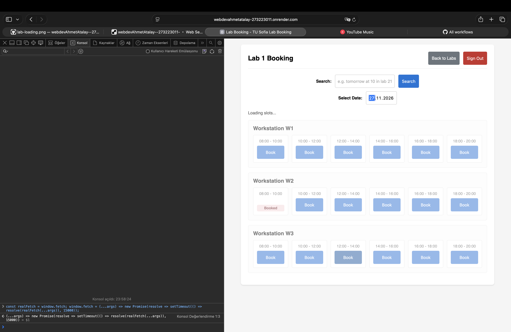
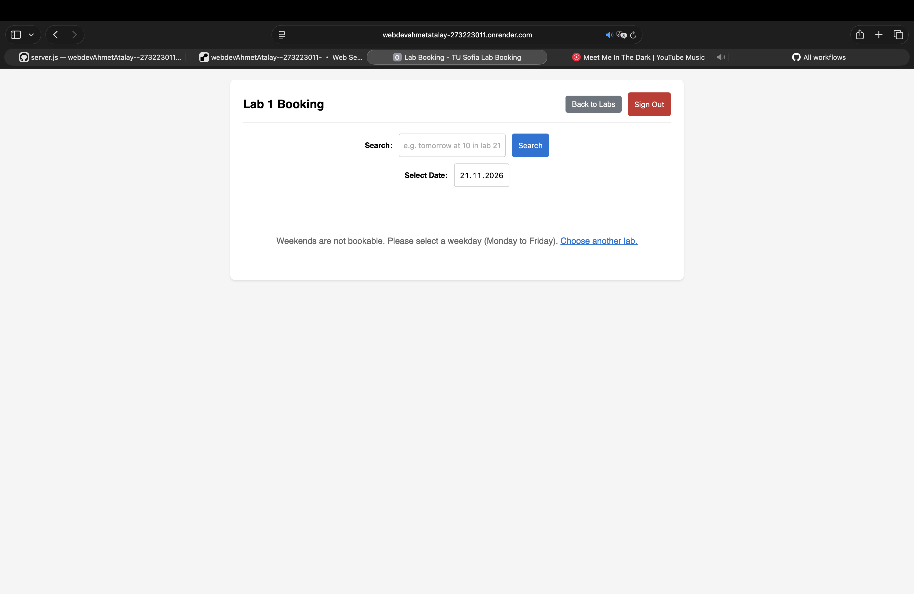
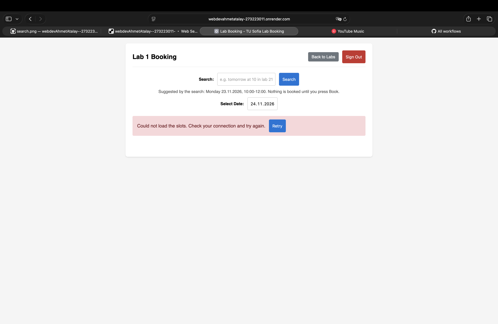
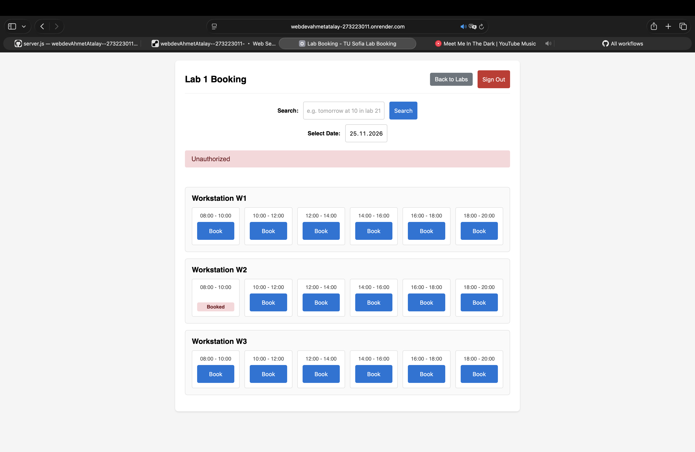
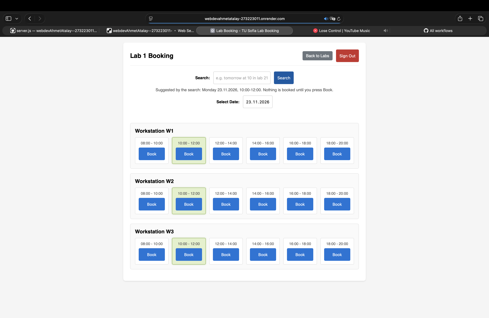
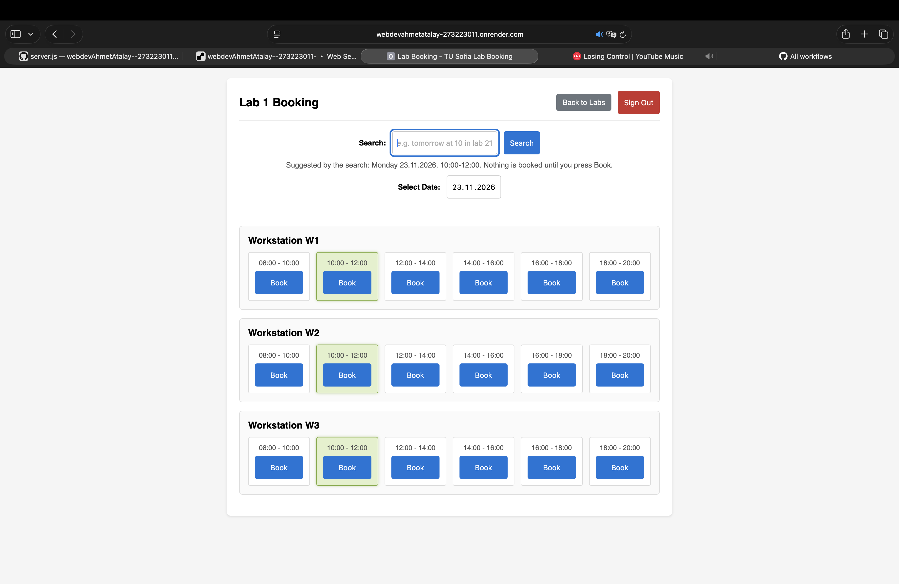
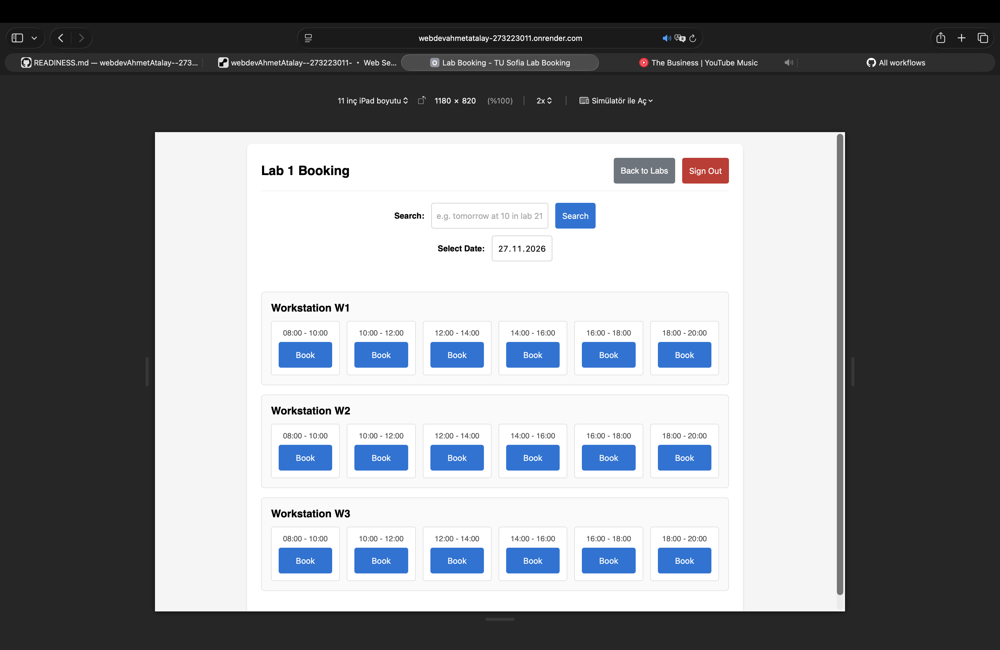
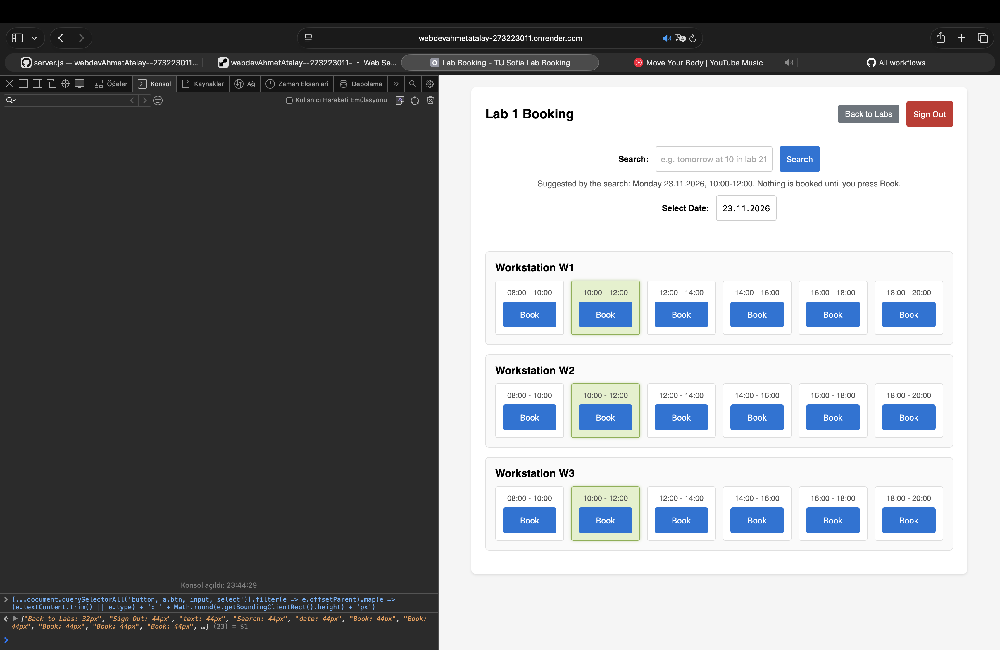
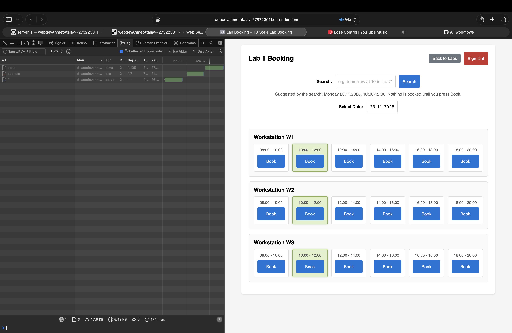

# UI checklist

"Modern" is not a style. It is a short list of things a user notices when they are
missing: the screen tells you what is happening, you can get through it with a keyboard,
the text is readable, and nothing jumps around while it loads.

## Layout and typography

- [x] **One spacing scale and one type scale.** Sizes come from a small set of design tokens, not from numbers typed where they were needed.
  - how I checked: all four pages link `public/assets/app.css`, whose `:root` holds the tokens: colours by role, a spacing scale `--space-1` to `--space-8` (4 to 40 px) and a type scale `--text-xs` to `--text-3xl` (12 to 24 px). The pages use only `var(--...)`, and a test in `src/pages.test.mjs` fails if a hex colour is left in `public/*.html`. The type scale has seven sizes, because I kept the sizes the pages already had instead of changing how they look.
- [x] **Responsive at 380, 768 and 1280 pixels wide.** No horizontal scrollbar, no text running under another element.
  - how I checked: 375 px in Exercise 3 (AC-12: the viewport tag and no fixed width over 375 px, tested in `src/pages.test.mjs`); 820 px in Safari's Responsive Design Mode as an 11-inch iPad in portrait (`docs/ui/tablet-820.png`); about 1190 px on my laptop (the other screenshots). No horizontal scrollbar and no overlapping text. 768 px itself was not tried: Safari offered 820 as the nearest tablet width.
- [x] **Nothing jumps while the page loads.** Images and cards reserve their space before their content arrives.
  - how I checked: changing the date keeps the old grid in place, dimmed, and writes "Loading slots..." into a status line whose height is reserved even when it is empty, so nothing on the screen moves (`docs/ui/lab-loading.png`). On the first visit there is no old grid yet: the page grows below the date picker, but nothing already on the screen moves.

## The four states, on every screen

A screen that only handles "it worked" is a screen that lies to the user on the day it matters.

- [x] **Loading.** Something tells the user the app is working, within about 100 ms.
  - how I checked: on the booking screen, "Loading slots..." appears in the status line as soon as the date changes (`role="status"`, so screen readers hear it), while the old grid stays dimmed (`docs/ui/lab-loading.png`, every request delayed by 15 seconds from Safari's console). The labs list has its own "Loading labs..." in the code, but I did not check it by eye.
- [x] **Empty.** The screen says what this list is for and what to do next, instead of showing nothing.
  - how I checked: on the booking screen, a weekend date shows "Weekends are not bookable. Please select a weekday (Monday to Friday)." with a "Choose another lab" link (`docs/ui/lab-empty.png`); in the code, a lab without workstations says "This lab has no workstations yet."
- [x] **Error.** A sentence a person can read. Never a raw JSON body, never a stack trace, never just "Error".
  - how I checked: with Wi-Fi off, the booking screen shows "Could not load the slots. Check your connection and try again." with a Retry button, and the old grid is removed, so no Book button points at another date (`docs/ui/lab-error.png`). Booking or cancelling without a connection shows "Could not reach the server. Check your connection and try again."; the search shows "Search is not available right now. Please choose the day and time yourself." Both are tested in `src/pages.test.mjs`. Not perfect yet: when the server has forgotten the session (after every restart, gap 1 in READINESS.md) the page shows the server's one word "Unauthorized" instead of sending the user to sign in, and after a failed load the search suggestion line stays on the screen.
- [x] **Success.** The user can see that what they did took effect, without reloading the page to find out.
  - how I checked: booking a slot on the live site turned it into "Cancel" and "Add to Google Calendar" at once, without a reload (AC-2; seen on 2026-11-20).

## Keyboard and accessibility

- [x] **The main flow works with the keyboard alone.** Sign in, do the core action, sign out, without touching the mouse.
  - how I checked: with Safari's "Press Tab to highlight each item on a webpage" turned on, I signed in, opened Lab 2140, booked a slot, cancelled it and signed out using only Tab, Shift+Tab and Enter. Every control is a native `<a>`, `<button>` or `<input>`; nothing is a clickable `
`.
- [x] **The focused element is visible.** A `:focus-visible` outline that is not switched off.
  - how I checked: `public/assets/app.css` has `:focus-visible { outline: 3px solid var(--color-focus); outline-offset: 2px; }` (#0275d8, 4.6:1 on white), no rule removes an outline, and a test checks the rule is there. Seen on the search box after Tab (`docs/ui/focus.png`).
- [x] **Text contrast is at least 4.5:1.** Name the tool you measured with.
  - how I checked: a Node script with the WCAG 2 contrast formula, on the colours now in `public/assets/app.css`: Book button 4.63, Back to Labs 4.69, error box 8.25, loading and empty text 5.74, labels 7.46, links 4.63. The red buttons (Cancel, Sign Out, Sign in with Google) were 3.96:1; changed from #d9534f to #c9302c (5.33:1), hover #a52a26 (7.10:1), commit 9bef138. The browser's placeholder grey was not measured.
- [x] **Every input has a label** a screen reader reads, not just placeholder text.
  - how I checked: `grep -n "<label" public/*.html`: all seven inputs (email, password, search, date, lab, workstation name, week) have a `<label for="...">` that points at the input's id.
- [x] **The page has a correct `<title>` and `lang`.**
  - how I checked: `grep -n "<html\|<title>" public/*.html`: all four pages have `lang="en"` and their own title ("Sign In", "Labs", "Lab Booking", "Staff", each followed by "- TU Sofia Lab Booking").
- [x] **Touch targets are at least 44 pixels.**
  - how I checked: measured in Safari's console with `getBoundingClientRect()` on every visible button, link styled as a button, input and select: all were 44 px except "Back to Labs", a link styled as a button, at 32 px (`docs/ui/touch-target.png`). Fixed with an `a.btn` rule in `app.css` (commit bf2c2c2, with a test); afterwards "Back to Labs" is as tall as "Sign Out" (`docs/ui/lab-loading.png`).

## The model feature

- [x] **It shows that it is thinking.** A model call is slow and a free service may have been asleep; a frozen button is the worst possible answer.
  - how I checked: `public/lab.html`: "Searching..." appears and the Search button is disabled until the answer or the fallback arrives; the server gives up on the model after 5 seconds.
- [x] **It shows when it failed,** and the rest of the screen still works.
  - how I checked: on the live site, "tomorrow at 10 in lab 2140" on a Friday evening (tomorrow is a Saturday) picked no slot, and the date picker and the slots kept working. Without a key, on a timeout or on a bad answer the box shows "Could not understand the request, please choose the day and time yourself" (tests AC-16 and AC-22). A failed request shows "Search is not available right now. Please choose the day and time yourself."
- [x] **The user can tell the model's suggestion from a fact.** It is labelled as a suggestion, not presented as data the app knows.
  - how I checked: after "Monday at 10 in lab 2140" the screen says "Suggested by the search: Monday 23.11.2026, 10:00-12:00. Nothing is booked until you press Book." above the highlighted slots (`docs/ui/search.png`).

## Decisions

- [x] **Dark mode, or a written decision not to have one.**
  - what I decided and why: no dark mode for now. The colours are now tokens in one file, so a dark theme would be one `@media (prefers-color-scheme: dark)` block that redefines them and a contrast check of the new pairs; I left it out to keep this exercise about readiness. It is listed with the other gaps in READINESS.md.

## Evidence

The booking screen on the live site, in Safari:

